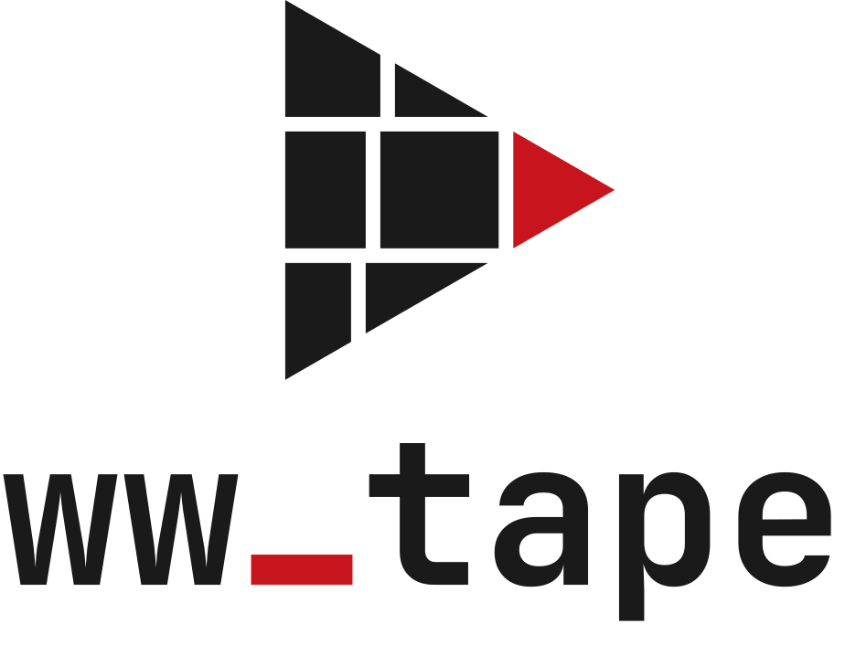

<p align="center">
  <picture>
    <source media="(prefers-color-scheme: dark)" srcset="assets/logo/ww_tape-dark.svg">
    
  </picture>
</p>

[](https://github.com/vhrdtech/ww_tape/actions/workflows/ci.yml)

> Tracks of ShrinkWrap records in self-checking, variable-length blocks, for live feeds, log files and raw media.

A **tape** is how [WireWeaver](https://github.com/vhrdtech/wire_weaver) records data over time. It holds what a device
streamed, what crossed a link and what a program computed from either.

One format serves a live feed, a file on a personal computer (PC) and a raw medium. An example of a raw medium is a
Secure Digital (SD) card in a data logger.

- **Typed data.** Every item is a ShrinkWrap type, and the file carries the API bundle that defines it.
- **Exact time.** Times are integer ticks of a named clock with an exact rate; a file holds tracks on many clocks.
- **Reads in place.** Large tracks are stored in columns that a reader queries as they lie in the file.
- **Damage stays local.** A crash, a torn write or a flipped bit costs the bytes it touched, and a reader says what
  was lost.

With the `alloc` feature, `ww_tape` is `no_std` and builds for `wasm32-unknown-unknown`. It then has the positional
reader, the writers and the piece chain on a sink of the caller's. The `std` feature (the default) adds memory sinks, the
system clock, reading blocks from a stream and owned definitions.

`ww_tape_fs` writes files and holds everything that names a path. Both crates depend on
[shrink_wrap](https://github.com/romixlab/shrink_wrap), [exact_units](https://github.com/romixlab/exact_units) and
`ww_version` from [ww_base](https://github.com/vhrdtech/ww_base), and on nothing of the WireWeaver framework.

## Documentation

The pages in [`docs/`](docs) explain the format. They start with these:

- [Tapes](docs/index.md): records, clocks, the anatomy of a file;
- [Events and series](docs/events_and_series.md);
- [Damage and recovery](docs/recovery.md);
- the [Format reference](docs/format.md).

The pages form the ww_tape book, which `just book` builds with Zensical.

The ww_tape book stands apart from the [WireWeaver book](https://ww.vhrd.tech/) and the
[logring book](https://vhrdtech.github.io/logring/), and it links to them by URL. The exact byte layouts are in the
crate's module docs.

## Repository layout

| Path | What |
| --- | --- |
| `ww_tape/` | the format: blocks, definitions and state on track 0, chunks, codecs, summary heads, index, pieces, writers and readers; `golden/` the golden files |
| `ww_tape_codecs/` | column codecs with no notion of a block (bit packing, CRC-32C, varints, lz4, samples, times, payload lengths, summary kernels), re-exported by `ww_tape` |
| `ww_tape_summary/` | summary trees: event item trees and series statistics, built into summary blocks and read from them |
| `ww_tape_fs/` | files: the file sink and store of piece files, their lock, writers and chains opened by path |
| `ww_tape_tests/` | the integration tests, through the public API of `ww_tape`, `ww_tape_fs` and `ww_tape_summary` |
| `ww_tape_fuzz/` | fuzz target bodies, hostile block builders, the seed files (`seeds/`) and their replay as tests |
| `ww_tape_codecs_benchmarks/` | the float sample codec benchmark |
| `ww_tape_benchmarks/` | the series summary, tracks, starts, relations and chunk writer benchmarks |
| `fuzz/` | cargo-fuzz targets (`tape-*`), a workspace of its own on nightly |
| `docs/` | the pages of the format |

`just --list` shows the recipes: `just test`, `just lint`, `just check`, `just fuzz-tape-<target>`,
`just bench-sample-codecs`, `just bench-summaries`, `just bench-tracks`, `just bench-chunks`, `just tape-golden-update`.

## Depending on it

```toml
[dependencies]
ww_tape = { git = "https://github.com/vhrdtech/ww_tape", default-features = false, features = ["alloc"] }
```

Leave out `default-features = false` for memory sinks, the system clock and stream reading (`std`). To write files, add
`ww_tape_fs = { git = "https://github.com/vhrdtech/ww_tape" }`.

## License

The Massachusetts Institute of Technology (MIT) License, see [LICENSE](LICENSE).
